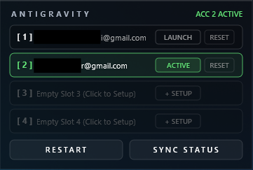

# Antigravity Account Switcher

Fast 1-click multi-account switcher for **Google Antigravity IDE**, built as a lightweight desktop widget for **Rainmeter**.

<p align="center">
  
</p>

## Requirements
- [Rainmeter](https://www.rainmeter.net/) (v4.5+)
- [Python 3.x](https://www.python.org/) *(must be added to PATH)*
- Google Antigravity IDE

## Installation
1. Clone or download this repo into your Rainmeter skins folder:
   ```text
   Documents\Rainmeter\Skins\Antigravity-Switcher
   ```
2. Open **Rainmeter**, select `Antigravity-Switcher.ini`, and click **Load**.

## Usage
- **Slot 1:** Auto-binds to your currently signed-in account.
- **Add Account:** Click **+ SETUP** on an empty slot, log in, then click **SYNC STATUS**.
- **Switch:** Click any configured slot or **LAUNCH** to swap accounts instantly.
- **Reset:** Click **RESET** to clear that slot's credentials.

---

Created by **[VAGENT](https://github.com/IamVAGENT)** • [MIT License](LICENSE)
